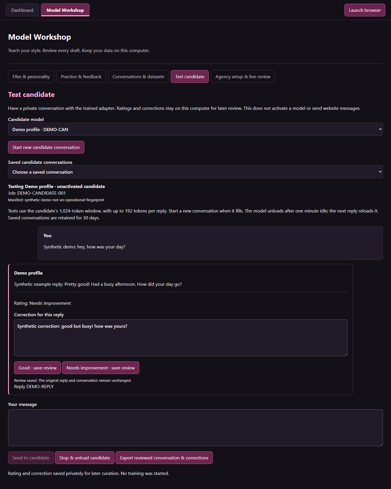
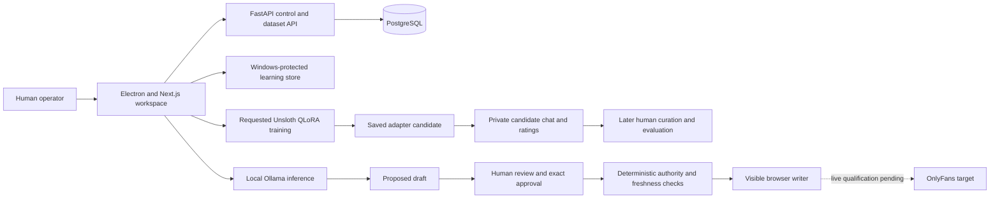

# Rapport Builder

**The public showcase for OF-Chatter: a local-first AI conversation workspace with human supervision.** The Windows application is named **Chatter Control**.

**Current local preview · November 10, 2026:** Chatter Control **0.10.0**, with the companion **Qwen Desktop 0.7.3**. The installed preview supports named profiles, document and dataset preparation, requested local fine-tuning, private conversations with trained candidates, reply ratings/corrections, embedded browsing and supervised review.

This repository contains public documentation and synthetic screenshots. Application source, private conversations, account records, model weights, adapters and installers are not published here.

> **Qualification boundary:** a completed local training run and two-turn adapter inference were verified. Those observations do not establish response quality, live OnlyFans compatibility, delivery reliability or production readiness. Every app-controlled platform send still requires human approval.

## Test a trained candidate before activation

*Actual 0.10.0 application web UI, captured November 10, 2026 with a synthetic desktop bridge and explicitly synthetic messages. The reply is a fixture, not model output. No real profile, training result or account is shown.*

[Full gallery](docs/GALLERY.md) · [Capability and validation snapshot](docs/CURRENT-STATE.md) · [Screenshot provenance](docs/screenshots.json)

## What the local preview can do

| Area | Implemented experience |
| --- | --- |
| Windows desktop | Click-to-open application, per-user Setup installer and ZIP candidates; bundled dashboard, API and private PostgreSQL startup. |
| Unified Model Workshop | Files & personality, Practice & feedback, Conversations & datasets, Test candidate, and Agency setup & live review. Highlighted tabs share a plum/pink theme. |
| File intake | TXT, Markdown, CSV, JSON/JSONL, text PDF and DOCX, with bounded extraction, previews, source hashes and quarantine. Supported Word layouts preserve sender roles. |
| Named profiles | Saved instructions, profile revisions and dataset assignments. Profile selection and trained-weight activation are separate actions. |
| Local data preparation | Qwen can locate requested files, extract conversations and assign returned dataset versions. Missing roles or examples are reported rather than invented. |
| Dataset curation | Redaction, frozen versions, independent Studio review, purpose-specific exports, expiry and revocation. Local owner-delegated data is explicitly distinguished from independently reviewed Studio data. |
| Requested fine-tuning | Unsloth QLoRA on **mlabonne/Qwen3-8B-abliterated**, using a 4-bit base and rank 16. Start/cancel controls, durable jobs, manifests and saved adapter artifacts. |
| Private candidate chat | Multi-turn conversations with the exact saved LoRA, without activating it or connecting it to a website. The job and manifest identify the tested version. |
| Ratings and corrections | Good/Needs improvement ratings, separately saved corrections, original replies retained, encrypted saved conversations and explicit review exports. Saving feedback does not retrain. |
| Qwen companion | Requested data preparation/training, live job/results lookup and connection recovery through Chatter's authenticated local interface. Result reviews resolve the latest profile request rather than an old chat ID. |
| Embedded browser | Visible Chromium, manual login/navigation and opt-in local AI overview of sampled visible page text. |
| Agency workflow | Account/profile/model mappings, OBSERVE/SUPERVISED operation, response flags and later review/curation. |
| Supervised writer | Bound account, recipient and fields; explicit draft placement and one approved send; durable intent, reconciliation, stale-context rejection and emergency stop. |

The browser approval lane has been exercised on synthetic fixtures. It has **not** been qualified for real OnlyFans delivery. AI observation is sampled and does not capture every activity, media stream or transient change.

## A deliberate training and evaluation workflow

1. Import or prepare conversations with supported role labels or structured formats. Original files stay intact.
2. Assign authorized dataset versions to the intended saved profile.
3. Explicitly request fine-tuning. A compatible local CUDA Python environment and original model weights are required.
4. Inspect the completed job, manifest, adapter files and held-out loss where evaluation is available.
5. Open **Model Workshop → Test candidate**, select the completed job and have a private conversation. Rate replies and save corrections for later curation.
6. Evaluate the candidate before a separate, explicit activation decision. No candidate test or rating activates a model or sends a website message.

Any nonempty valid dataset can train; there is no fixed example/group minimum. Resource limits, source integrity, authorization, expiry and revocation still apply. If no separate holdout is available, the result records unavailable metrics rather than inventing them.

Candidate tests use a **1,024-token window** and up to **192 generated tokens per reply**. Oversized conversations are rejected without silently dropping history. Saved candidate conversations are retained for **30 days**. Model loading can take time; the worker unloads after one minute idle or when the test is stopped/closed. Other GPU workloads can compete for memory.

## Human approval before platform execution

The model proposes wording. Deterministic software controls app-mediated writes.

1. Bind the intended account, recipient, transcript and message fields, and load the issued authority record.
2. Prepare and inspect the draft.
3. Explicitly authorize placement into the website editor.
4. Inspect the field, then approve one exact send or deny it.
5. Verify delivery and reconcile the recorded intent. A click is not a delivery acknowledgement; the app does not automatically retry sends.

New messages, navigation, changed recipients, manual edits, stale drafts and changed authority invalidate approval. Pause and emergency stop constrain app-controlled writes. Qwen's workshop interface cannot approve or send messages for the operator. These controls do not constrain direct human actions on a website.

## Architecture

**Stack:** Electron / Chromium · Next.js / React / TypeScript · FastAPI / Python · PostgreSQL · Ollama · Unsloth / PEFT. Model weights and the optional CUDA training environment are not bundled with the installer.

## Verification and remaining work

For the **0.10.0 candidate-chat change**, local checks passed **62 desktop tests**, **four relevant dashboard tests**, **two Python tests**, targeted lint, type checking and the dashboard production build. Packaged checks exercised isolated PostgreSQL/API/BFF startup, candidate navigation, Windows encryption, restart persistence and clean shutdown. Installed native modules and the candidate worker matched the verified build. A real saved adapter generated two turns with previous-turn context.

These are scoped local results, not hosted application CI clearance or a model-quality benchmark. Lower held-out loss does not establish personality fidelity or acceptable live behavior. Raw trainer output is not retained as a complete step-by-step log or loss curve.

Remaining work includes independent application-source review, authorized application CI, human candidate evaluation, real-platform qualification, signing, endurance testing and release/recovery hardening. The desktop remains an **unsigned local preview**; this repository offers no public application download or implementation-source release.

The **Docs CI badge validates this public portfolio only**. It does not certify application release gates, model quality or live-platform readiness. The [authorization schema](docs/sample-authorization.schema.json) is a reduced public illustration, not an issued runtime authority record.

## Contact and license

For a walkthrough or architecture discussion, email **nguyen.jimmy.2898@gmail.com**.

Public documentation and portfolio artifacts are © 2026 Jimmy Nguyen. All rights reserved; see [LICENSE](LICENSE). Private source, customer conversations, credentials, authority records, datasets, model weights and adapters are not included.
