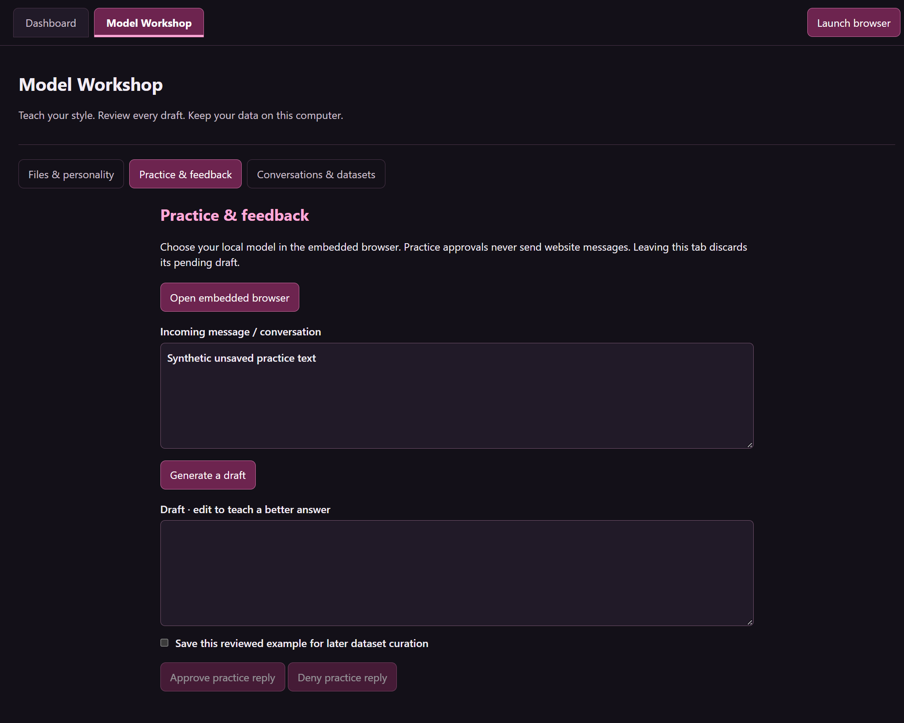
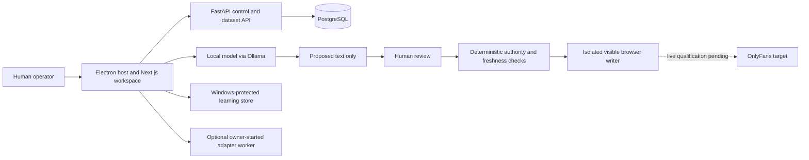

# Rapport Builder

**The public showcase for OF-Chatter, a local-first, human-supervised AI conversation workspace.** The Windows application is named **Chatter Control**.

**Current state · October 28, 2026:** an implemented and locally installed **0.5.1 Windows preview**, with an embedded browser, a unified Model Workshop and explicit human approval controls. The application has progressed beyond the earlier design-only portfolio. This repository contains documentation and synthetic-data screenshots; private source, customer data, model weights and installers are not published here.

> **Qualification boundary:** local synthetic tests exercise the approval/send implementation. Actual OnlyFans compatibility and live delivery have not been verified. No live-account operating results, trained-model quality or production readiness are claimed.

## See the application

*Actual installed 0.5.1 screenshot, captured October 26, 2026. The text is a synthetic fixture, not model output. No real account or customer conversation is shown.*

[Screenshot gallery](docs/GALLERY.md) · [Capability and validation snapshot](docs/CURRENT-STATE.md) · [Public authorization example](docs/sample-authorization.schema.json)

## What works today

| Area | Implemented experience |
| --- | --- |
| Windows desktop | Click-to-open application, per-user installer and ZIP review candidates. The package starts its dashboard, API and private PostgreSQL database. |
| Workspace navigation | Persistent **Dashboard** and **Model Workshop** tabs, an explicit active highlight and a shared dark plum/pink theme. |
| Model Workshop | **Files & personality**, **Practice & feedback**, and **Conversations & datasets** in one workspace. File/personality and dataset edits survive section switches. |
| File intake | TXT, Markdown, CSV, JSON, text PDF and DOCX; previews, source hashes and quarantine. Larger Word documents split into sections. Failed batches add nothing; retries skip imported sections. |
| Customization | Saved personality, style and requirements, with references linked to independently reviewed datasets. Uploading a file does not train a model. |
| Practice | Operator-requested local-model drafts, editable corrections and approve/deny feedback. Capturing teaching examples requires opt-in. Practice approval never sends website messages. |
| Dataset curation | Conversation import, redaction, preview, frozen versions, independent review, purpose-specific exports, expiry and revocation. |
| Embedded browser | Visible Chromium, manual login/navigation and optional local AI overview of sampled visible page text. |
| Supervised messages | Select account, recipient, transcript, editor and Send button; prepare, explicitly place, approve one send or deny. Manually reconcile delivery before resuming. |
| Owner-started fine-tuning | Muse / Gemma2 9B candidate setup checks and start/cancel controls. Separate original weights, CUDA environment and an approved training export are required. No completed run or qualified adapter is claimed. |

The operator dashboard labels its simulated conversations as **synthetic**. The native browser approval lane is separate and governed by its own account-authority checks. A working simulator does not establish a qualified live connector.

## Human approval before execution

The model proposes text. Deterministic software controls whether the application may write.

1. The operator selects the conversation and loads its issued local Control Room runtime record.
2. The model drafts from the selected transcript, saved instructions and permitted references, or the operator prepares their own text.
3. The operator reviews the wording and explicitly authorizes **Place draft in message field**. This is separate because a website may autosave field contents.
4. The operator inspects the field and chooses **Approve & send** or **Deny**. Approval applies to the exact message and conversation state.
5. The application records a send intent before clicking. A click remains uncertain until the operator verifies delivery and reconciles it. There is no automatic send retry.

New messages, navigation, recipient changes, manual edits, stale drafts and changed authority invalidate approval. Pause discards it; emergency stop latches app-controlled writes off. The native writer checks the deterministic authority contract. The model cannot approve itself. Direct human website actions are outside this writer lane.

**This flow has been exercised on local synthetic chat fixtures, not qualified live OnlyFans sessions.**

## Architecture in the current preview

**Implemented stack:** Electron · Chromium / WebContentsView · Next.js / React / TypeScript · FastAPI / Python 3.12 · PostgreSQL · local Ollama inference · Python authorization contracts · Playwright-based synthetic checks.

The optional Muse / Gemma2 9B training worker uses original compatible weights and a separate CUDA Python environment. Models and training dependencies are not bundled with the desktop installer. Adapter candidates never activate automatically for inference or sending.

## Data and control boundaries

- Imported reference text and profile settings use Windows-protected encrypted storage. Original files, explicit exports and adapter outputs are outside that store and need separate handling.
- Quarantined uploads are untrusted data. Only currently permitted, integrity-checked dataset exports enter reference generation or training preparation.
- The guest browser is sandboxed and isolated from the application bridge. Sessions are temporary and AI observation is opt-in; sampling does not capture every activity, frame, media stream or transient change.
- Account/recipient binding, exact-message approval, stale-context rejection, durable intent, reconciliation and emergency stop constrain app-controlled writes.
- The local audit is hash chained, not externally anchored and immutable. A browser click is not a delivery acknowledgement.

The [public authorization schema](docs/sample-authorization.schema.json) remains a reduced illustration, not the full private runtime contract.

## Verification and remaining work

Recorded **0.5.0** validation passed **34 desktop tests and 11 targeted dashboard tests**, plus installed-app and synthetic browser checks. The **0.5.1** navigation update passed **11 targeted dashboard tests**, lint/type checks, a dashboard production build and installed navigation/upload/persistence checks. Installed integrity checks matched **5,578 runtime files** to their SHA-256 manifest. These are milestone-specific results, not a claim that the entire suite ran on the latest head.

The [current-state snapshot](docs/CURRENT-STATE.md) distinguishes implemented features, exercised scenarios and remaining qualification:

- Actual OnlyFans account binding, site compatibility and delivery require live qualification.
- No completed fine-tuning run, accepted adapter or trained-model quality result is claimed.
- The desktop package is an **unsigned review preview**. Signing, independent release review, application CI clearance and production hardening remain.
- No public application download or implementation-source release is offered here.

The **Docs CI badge validates this public portfolio only**. It does not certify application release gates, model quality or live-platform readiness.

## Contact and license

For a walkthrough or architecture discussion, email **nguyen.jimmy.2898@gmail.com**.

Public documentation and portfolio artifacts are © 2026 Jimmy Nguyen. All rights reserved; see [LICENSE](LICENSE). Private source, customer conversations, credentials, authority records, datasets, model weights and adapters are not included.
