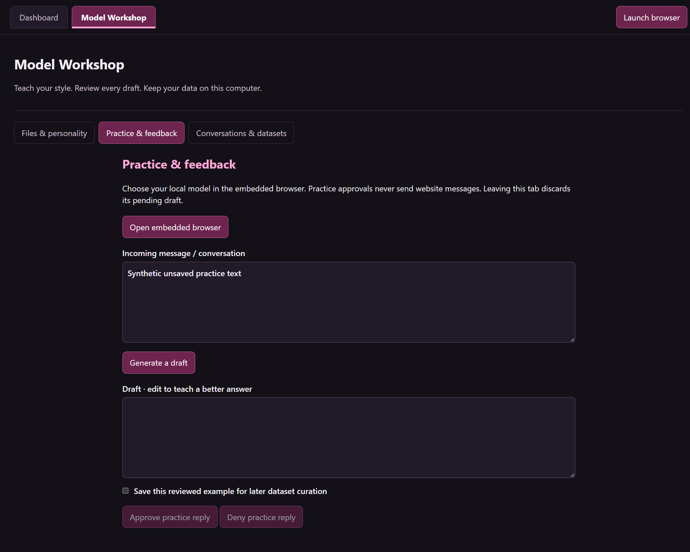
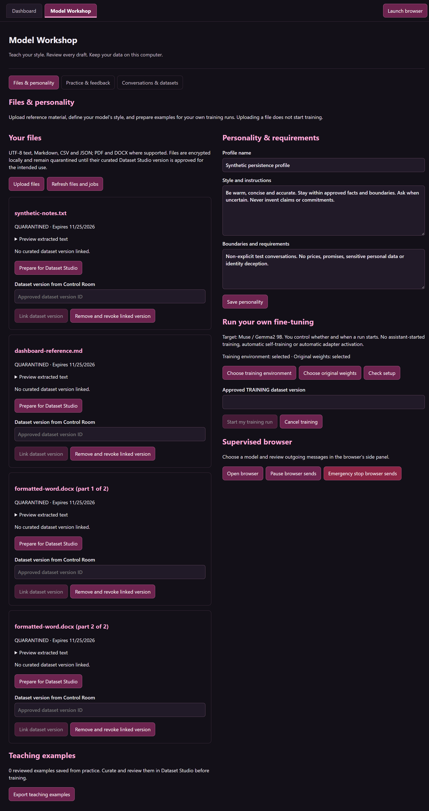
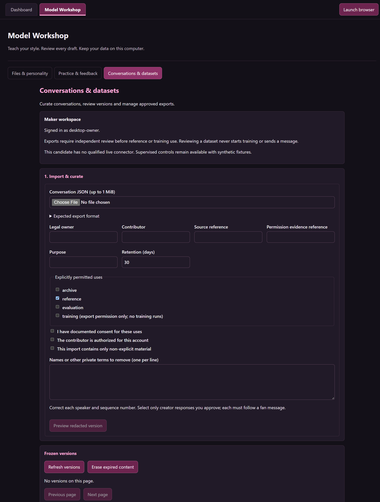
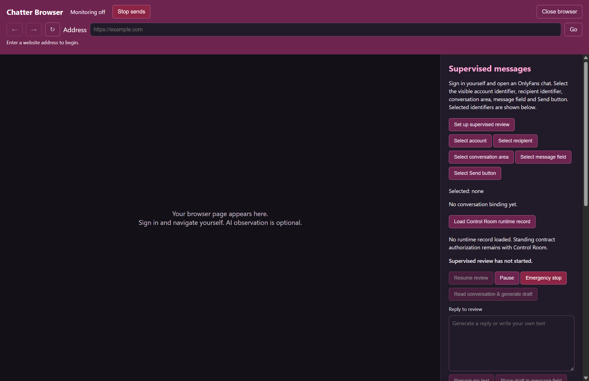
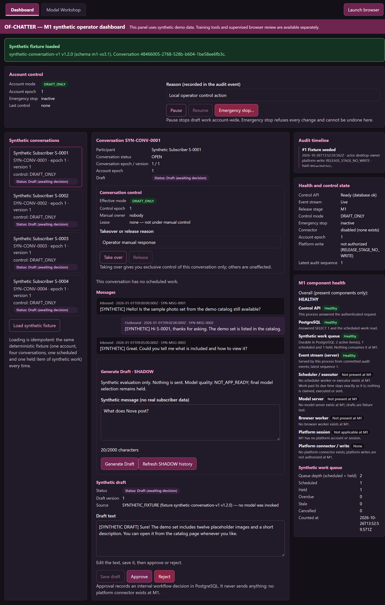

# OF-Chatter application gallery

Actual screenshots of the installed **Chatter Control 0.5.1** preview, captured **October 26, 2026**. Messages, file names and account-like identifiers shown are synthetic fixtures. No real platform session, private document or customer conversation is shown. Screenshots establish the implemented interface, not platform compatibility or model quality.

[Showcase](../README.md) · [Validation and limits](CURRENT-STATE.md) · [Image hashes](screenshots.json)

## Model Workshop: practice

The top bar identifies the active workspace. Drafts are editable; capturing a teaching example requires opt-in. The visible text was entered by the synthetic test, not generated by a model.

## Files and personality

Intake, previews, quarantine, dataset linking, personality and owner-started training controls share one section. The Word parts are synthetic parser fixtures. Available training controls do not establish a completed run.

## Conversations and datasets

Curation, rights records, redaction, review and approved exports live in the same workshop. The Maker view cannot impersonate the independent Checker.

## Embedded browser

Shown before navigation, with no account, conversation or runtime authority loaded. This is the actual control panel, not a qualified OnlyFans session.

## Synthetic operator dashboard

The dashboard explicitly labels sample conversations and the demo execution lane. These controls are separate from the native browser approval lane.

## Historical design

The earlier [design rendering](../assets/operator-view-redacted.svg) remains historical context. It is not current application evidence.
